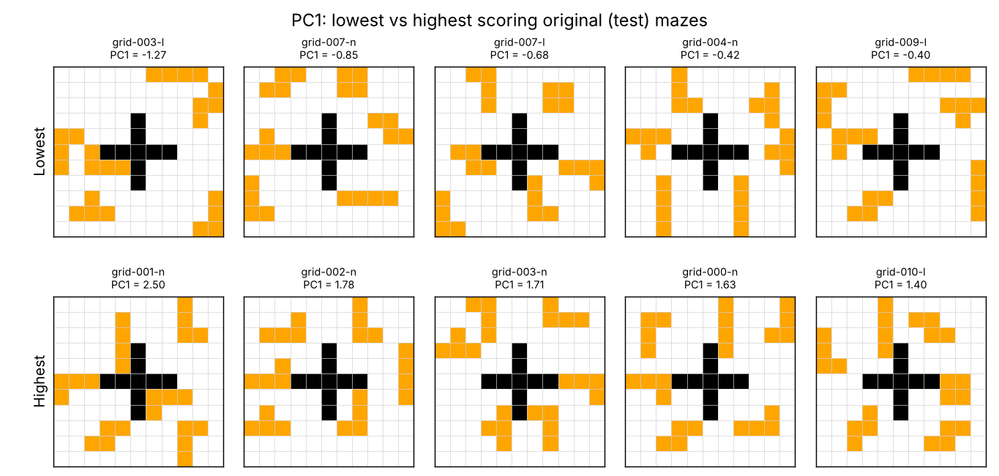
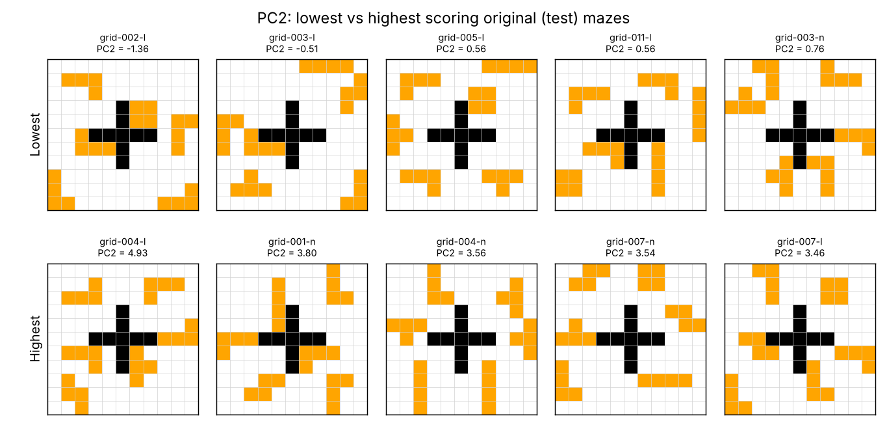
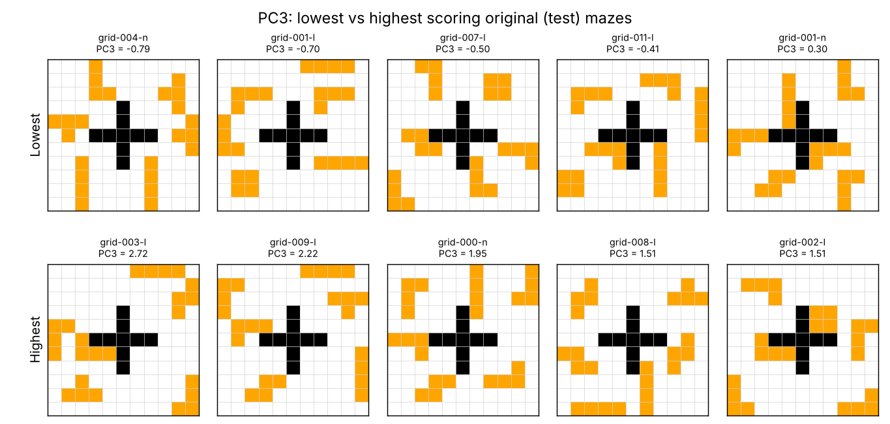

# Maze complexity measures

Code for generating the maze set, computing the complexity measures for each maze, and reducing them to a few complexity dimensions with PCA.

`Complexity_Measures.ipynb` does the following:

1. builds the maze set: the 12 original lateralized and 12 non-lateralized mazes, plus 100 new hemifield-balanced mazes
2. creates 100 start/goal (S/G) variants of each layout
3. computes layout measures once per base layout: symmetry, obstacle spacing, obstacle shape, edge density and local entropy
4. computes optimal path measures for every S/G variant
5. runs value-guided construal (VGC) on every solvable maze and records the optimal construal
6. summarises everything at the layout level

`maze_pca.R` then runs a PCA on the layout-level measures (see [Complexity dimensions](#complexity-dimensions)).

## Folder layout

```
.
├── Complexity_Measures.ipynb
├── maze_utils.py           # shared helpers (grid parsing, optimal path)
├── maze_pca.R              # PCA, permutation test, bootstrapped loadings, PC scores
├── visualize_mazes.py      # draws the mazes
├── make_readme_figures.py  # the PC figures below
├── docs/                   # figures used in this README
├── mazes/                        # maze layouts
│   ├── mazes_Lateralized.json    # 12 original lateralized mazes
│   ├── mazes_Nonlateralized.json # 12 original non-lateralized mazes
│   ├── mazes_generated.json      # the 100 generated layouts
│   └── mazes_sg_variants.json    # all S/G variants
├── metrics/                      # complexity measures from the notebook
│   ├── structure_metrics.csv     # one row per layout (PCA input)
│   └── *.csv                     # per-maze tables (git-ignored, large)
├── pca/                          # outputs of maze_pca.R
│   ├── pca_scores.csv
│   ├── pca_loadings.csv
│   ├── pca_variance.csv
│   └── pca_model.rds
├── environment.yml
└── requirements.txt
```

## Setup

```bash
conda env create -f environment.yml
conda activate vgc
```

The VGC model itself (`vgc_project`) isn't included in this repo. It comes from Ho et al. (2022), *People construct simplified mental representations to plan*, and the code is linked from the paper's OSF page: https://doi.org/10.17605/OSF.IO/ZPQ69

Install it into the same environment, or put the `vgc_project/` folder next to the notebook, so that this import works:

```python
from vgc_project.vgc import value_guided_construal
```

## Running

Open the notebook from the repo root and run it top to bottom. The paths in the notebook are relative to the root.

The VGC step (section 6) is by far the slowest part. It runs in parallel and leaves 3 cores free. Its output is saved to `metrics/maze_with_path_complexity_metrics.csv` as soon as it finishes, so you can start a later run from section 7 without redoing VGC.

## Complexity dimensions

`maze_pca.R` fits a PCA on 15 standardised layout-level measures of the 100 generated layouts. The 24 original mazes aren't used for fitting; they're projected onto the same components. Then the script:

- runs a permutation test (each column shuffled 1,000 times) to decide how many components to keep
- bootstraps the loadings (1,000 resamples) to get 95% CIs
- writes PC scores for all 124 layouts to `pca/pca_scores.csv`

```bash
Rscript maze_pca.R            # needs the ggplot2 and boot packages
python make_readme_figures.py
```

Only the first three components explain more variance than shuffled data (permutation p < .001; PC4 p = 1.00). Together they explain 63% of the variance.

The figures below show the five lowest- and five highest-scoring mazes on each component, taken from the 24 original mazes (the test set, which wasn't used to fit the PCA). S, G and paths aren't drawn, because the path measures in the PCA are averages over each layout's 100 S/G variants. Loading plots with bootstrap CIs and the permutation scree plot are in [`docs/pca/`](docs/pca/). To pick the examples from the training layouts instead, run `python make_readme_figures.py --set generated`.

### PC1 (31.8%): spread-out vs clustered obstacles (Global Visual Complexity)

High PC1 means obstacles packed close together and around the central wall: higher local entropy and edge density, and shorter, more even distances between obstacles. Optimal paths have fewer turns per step. Low PC1 means obstacles pushed out to the edges and corners, at uneven distances from each other.

 

### PC2 (17.1%): path and planning demands (Planning Complexity)

High PC2 means longer optimal paths with more turns, and larger optimal construals (more obstacles worth representing). The obstacle-layout measures barely load on this component.



### PC3 (13.9%): obstacle shape diversity (Local Visual Complexity)

High PC3 means more distinct obstacle shapes, rougher outlines and lower shape similarity between obstacles. Low PC3 means obstacles of similar, compact shapes.



The direction of each component is fixed in `maze_pca.R` (the `anchors` vector), so these descriptions stay correct when the script is re-run.

## Drawing the mazes

```bash
python visualize_mazes.py                 # overview page + one page of variants per layout
python visualize_mazes.py --individual    # also one PNG per maze (~12.5k files)
python visualize_mazes.py --ids grid-003-l grid-003-l-SG07 --labels

# just the 100 generated layouts the PCA was trained on, on one page
python visualize_mazes.py --files mazes/mazes_generated.json --overview-only --out figures/pca_training
```

Figures go to `figures/`, which is git-ignored. Walls are black, obstacles orange, S/G blue and the optimal path red. Mazes with no S-G path are marked "(no path)" in the title. This applies to 42 of the 100 generated base layouts: obstacles block their original S/G, and they're left out of the VGC step. All of their S/G variants are solvable.

## Outputs

| File | One row per | Contents |
|---|---|---|
| `mazes/mazes_generated.json` | new base maze | the 100 generated layouts (`grid-012-l` … `grid-111-l`) |
| `mazes/mazes_sg_variants.json` | S/G variant | every `<base_id>-SGxx` maze |
| `metrics/maze_complexity_metrics.csv` | maze (base + S/G variants) | layout and optimal path measures |
| `metrics/maze_with_path_complexity_metrics.csv` | solvable maze | the above plus the optimal construal, its size and the value of each construal |
| `metrics/structure_metrics.csv` | base layout | layout measures, plus path and VGC measures averaged over the S/G variants |

The large per-maze CSVs in `metrics/` are git-ignored. The maze JSONs, `structure_metrics.csv` and the PCA outputs are small and committed, so the README figures can be rebuilt without re-running the notebook.

`metrics/structure_metrics.csv` holds the layout-level measures the PCA was fitted on, from a run with VGC inverse temperature 5. Re-running the notebook overwrites it with values at the current setting (`INV_TEMP = 10`).

## Settings worth knowing

- `INV_TEMP = 10`: inverse temperature passed to VGC as `construal_inverse_temp`
- `n_variants_per_maze=100` and `min_manhattan=10` (section 3): how many S/G variants each layout gets, and the minimum distance between S and G
- `generate_many(100, TEMPLATE, blocks_per_obstacle=4, seed=123)`: the new mazes

Maze generation uses Python's `random` with fixed seeds. The mazes it produces depend on the Python version, because tuple hashing changed in Python 3.8. Use Python 3.7 to reproduce the original set.
